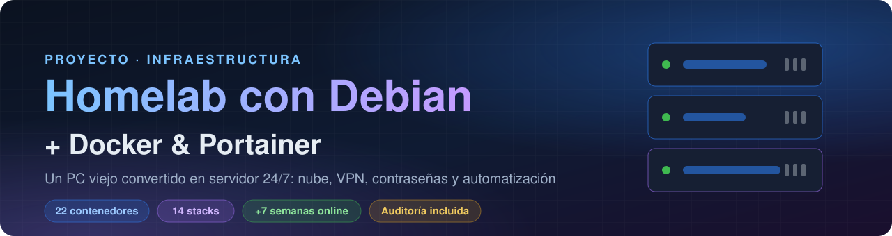
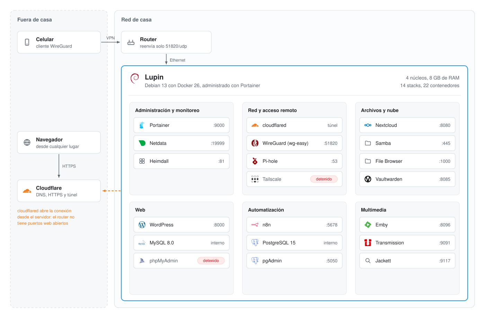
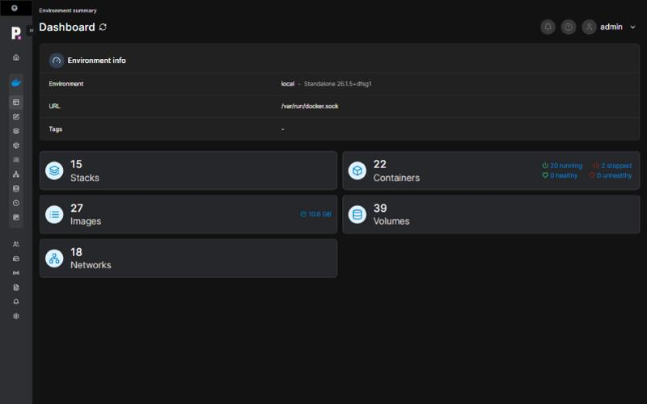
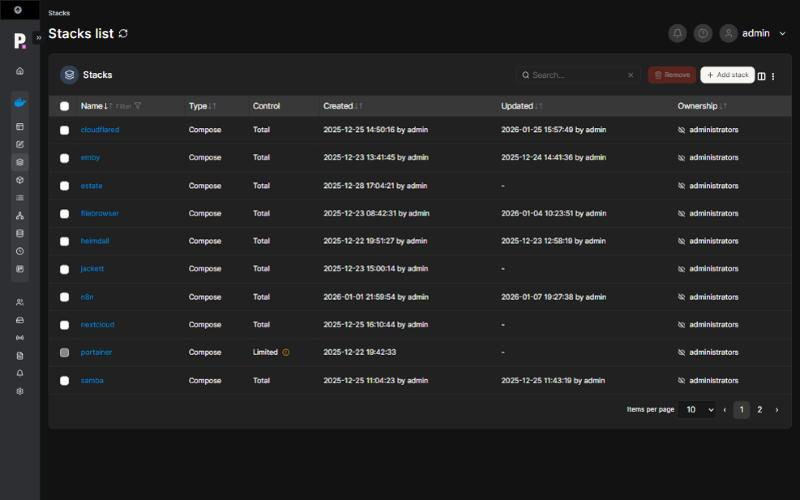
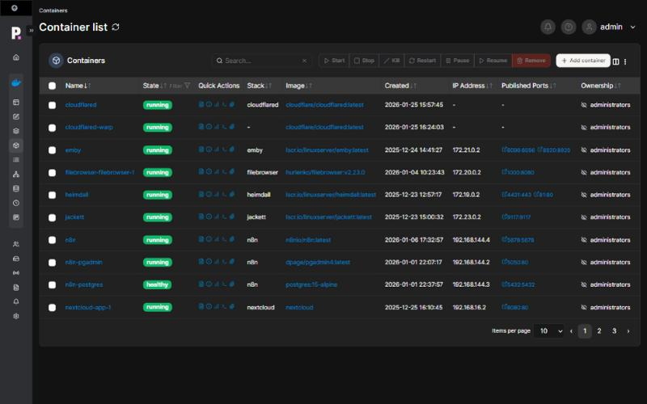
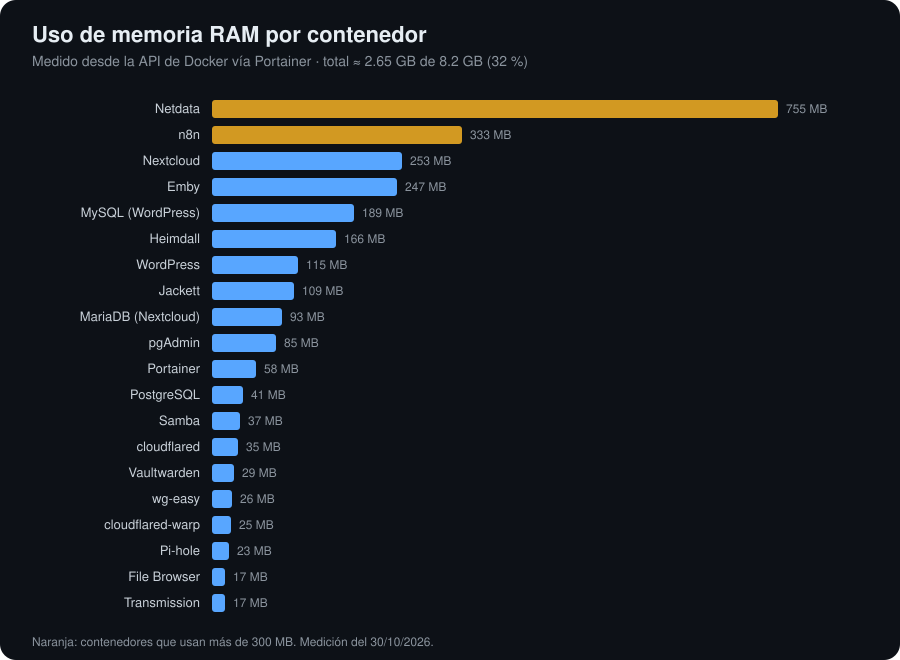
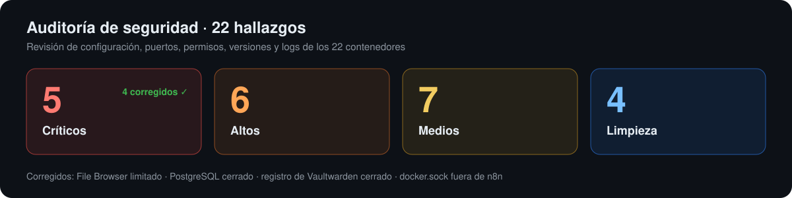

<p align="center">
  
</p>

<p align="center">
  
  
  
  
  
  
  
  
  
</p>

<p align="center">
  <b>Convertí un PC viejo que no usaba en un servidor doméstico que funciona 24/7.</b><br>
  Ofrece nube personal, VPN, bloqueo de anuncios, gestor de contraseñas, automatizaciones,<br>
  monitoreo y multimedia, y todo se administra desde el navegador.
</p>

<p align="center">
  <a href="#-arquitectura">Arquitectura</a> ·
  <a href="#-servicios">Servicios</a> ·
  <a href="#-capturas">Capturas</a> ·
  <a href="#-auditoría-de-seguridad">Auditoría</a> ·
  <a href="docs/INSTALACION.md">Instalación</a>
</p>

---

## ⚡ En números

<table align="center">
  <tr>
    <td align="center"><h2>22</h2>contenedores</td>
    <td align="center"><h2>14</h2>stacks</td>
    <td align="center"><h2>8 GB</h2>RAM · 4 CPU</td>
    <td align="center"><h2>~2,6 GB</h2>RAM en uso</td>
    <td align="center"><h2>+7 sem.</h2>sin reinicios</td>
    <td align="center"><h2>0</h2>puertos web abiertos</td>
  </tr>
</table>

| | |
|---|---|
| 🖥️ **Hardware** | PC de escritorio reciclado · x86_64 · conectado por **cable Ethernet** al router |
| 🐧 **Sistema** | Debian 13 (trixie) sin entorno gráfico · kernel 6.12 |
| 🐳 **Plataforma** | Docker 26 + Portainer CE · todo desplegado como stacks de Docker Compose |
| 🌐 **Acceso remoto** | Cloudflare Tunnel (HTTPS con dominio propio) + VPN WireGuard |

## 🏗️ Arquitectura

<p align="center">
  
</p>

- **Sin abrir puertos web:** los paneles se publican en internet mediante un **túnel saliente de Cloudflare**, con HTTPS y subdominios propios.
- **VPN propia:** con **WireGuard** me conecto a la red de casa desde el móvil, y **Pi-hole** bloquea los anuncios también fuera de casa.
- **Todo en contenedores:** cada servicio es un stack independiente que se puede actualizar, mover o borrar sin afectar a los demás.

## 🧩 Servicios

| | Servicio | Para qué lo uso |
|:-:|---|---|
| 🎛️ | **Portainer** | Desplegar y administrar todos los contenedores desde el navegador |
| 📈 | **Netdata** | CPU, RAM, disco, red y contenedores en tiempo real |
| 🏠 | **Heimdall** | Página de inicio con accesos directos a todo |
| 🌐 | **Cloudflare Tunnel** | Publicar servicios con HTTPS y dominio propio sin abrir puertos |
| 🔐 | **WireGuard (wg-easy)** | VPN para entrar a casa desde cualquier lugar, con panel web |
| 🛡️ | **Pi-hole** | Bloqueo de anuncios y rastreadores por DNS |
| ☁️ | **Nextcloud + MariaDB** | Mi propio "Google Drive" |
| 📁 | **Samba · File Browser** | Carpeta compartida en la red local y acceso desde el navegador |
| 🔑 | **Vaultwarden** | Servidor de contraseñas compatible con Bitwarden |
| 📰 | **WordPress + MySQL** | Sitio web autoalojado |
| 🤖 | **n8n + PostgreSQL** | Automatizaciones, bots y webhooks |
| 🎬 | **Emby · Transmission · Jackett** | Biblioteca multimedia con descargas automáticas |

## 📸 Capturas

<table>
  <tr>
    <td width="50%"><p align="center"><b>Panel de Portainer</b></p></td>
    <td width="50%"><p align="center"><b>Stacks de Docker Compose</b></p></td>
  </tr>
  <tr>
    <td colspan="2"><p align="center"><b>Contenedores en ejecución</b></p></td>
  </tr>
</table>

<p align="center">
  
</p>

## 🛡️ Auditoría de seguridad

Meses después de montarlo, **audité el servidor completo** revisando puertos, permisos, secretos,
versiones y logs. Lo documenté y corregí lo más grave.

<p align="center">
  
</p>

| Problema encontrado | Riesgo | Estado |
|---|---|:-:|
| File Browser podía ver **todo el disco** del servidor | Lectura y modificación de cualquier archivo | ✅ |
| PostgreSQL publicado en todas las interfaces | Ataques directos a la base de datos | ✅ |
| Registro abierto en el gestor de contraseñas | Cualquiera podía crearse una cuenta | ✅ |
| `docker.sock` dentro de n8n (el `:ro` **no** protege) | Un flujo comprometido controla el host | ✅ |
| Contraseña en texto plano en un compose | Exposición de credenciales | ⏳ |
| Tailscale caído: más de 60 000 reinicios por una clave caducada | Pérdida del acceso remoto | ⏳ |

➡️ **Informe completo, con las 22 correcciones: [docs/AUDITORIA.md](docs/AUDITORIA.md)**

Los archivos de [`stacks/`](stacks/) son la **versión corregida**: sin secretos (van en un `.env`
que no se sube, ver [`.env.example`](.env.example)), con los paneles publicados solo en `127.0.0.1`,
imágenes mantenidas, rutas reales y herramientas de administración que solo se levantan cuando hacen falta.

## 📂 Estructura

```
homelab-debian-docker/
├── 📄 README.md
├── 🔒 .env.example            variables necesarias, sin valores reales
├── 📚 docs/
│   ├── INSTALACION.md         cómo montarlo desde cero
│   └── AUDITORIA.md           hallazgos, severidad y correcciones
├── 🐳 stacks/                 un compose.yaml por servicio
├── 🛠️ scripts/
│   ├── backup-volumenes.sh    copia nocturna de volúmenes + volcado de PostgreSQL
│   ├── limpieza-docker.sh     elimina imágenes, volúmenes y redes sin uso
│   └── daemon.json            rotación de logs de Docker
└── 🖼️ images/                 diagramas y capturas
```

## 🚀 Cómo replicarlo

```bash
git clone https://github.com/JoseVargasBeen/homelab-debian-docker.git
cd homelab-debian-docker
cp .env.example .env        # rellenar con tus valores
cd stacks/portainer && docker compose up -d
```

Después, en Portainer: **Stacks → Add stack** y se pega cada `compose.yaml`. Guía completa en **[docs/INSTALACION.md](docs/INSTALACION.md)**.

## 🧠 Qué aprendí

- 🐧 Instalar y mantener **Linux sin interfaz gráfica**, administrado por SSH
- 🐳 **Docker Compose**: redes, volúmenes, healthchecks y políticas de reinicio
- 🌐 **Redes**: IP fija, reenvío de puertos, DNS, VPN y túneles inversos
- 🔒 **Seguridad**: secretos, mínimo privilegio, superficie de ataque y riesgos de `docker.sock`
- 🗄️ **Bases de datos** en producción: PostgreSQL, MySQL y MariaDB
- 🩺 **Operación**: monitoreo, lectura de logs, diagnóstico de caídas y copias de seguridad

## 🗺️ Próximos pasos

- [x] Montar el servidor y desplegar 14 stacks
- [x] Auditoría completa de seguridad
- [x] Limitar File Browser, cerrar PostgreSQL, cerrar el registro de Vaultwarden y quitar `docker.sock` de n8n
- [ ] Cambiar las credenciales expuestas y actualizar Portainer a la última LTS
- [ ] Cloudflare Access delante de Portainer, n8n y Netdata
- [ ] Copias de seguridad automáticas a un disco externo y a la nube
- [ ] Alertas por Telegram cuando un contenedor se caiga

---

<p align="center">
  Hecho por <a href="https://github.com/JoseVargasBeen"><b>José Vargas</b></a> · 🖥️ con un PC que iba a la basura
</p>
